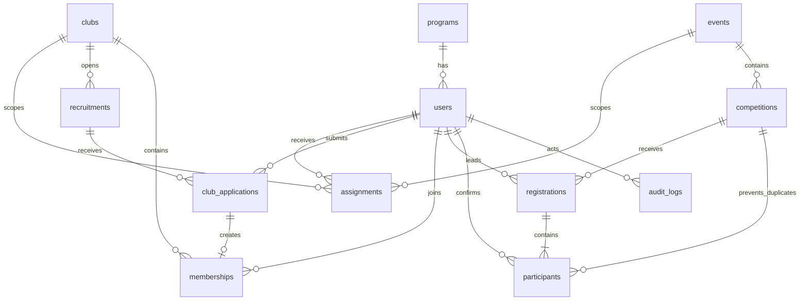

# Arsitektur BRUDEL

## Implementasi tahap pertama

Monolit Laravel 13 + Livewire 4 + Blade + Tailwind 4. Versi pasti berada pada `composer.lock` dan `package-lock.json`. PHP pengujian: 8.4.25. Backend produksi dirancang untuk PostgreSQL; database demo lokal dan tes saat ini memakai SQLite. Waktu disimpan UTC dan ditampilkan Asia/Makassar.

- Akun: `User`, `Assignment`, `AuthController`, middleware `PrivateResponse`.
- UKM: `Club`, `Recruitment`, `ClubApplication`, `Membership`.
- Event dan pendaftaran: `Event`, `Competition`, `Registration`, `Participant`.
- Aturan transaksi: `EnrollmentService`; HTTP controller melakukan validasi input, service memeriksa status, aktor, konflik kepentingan, dan kuota.
- Antarmuka: Blade server-rendered; pencarian/filter katalog menggunakan `Discovery` Livewire. Semua pengiriman formulir melewati CSRF Laravel.
- Audit: `audit_logs`, dicatat dalam transaksi keputusan yang sama.
- File: disk privat `local` untuk demo atau `s3` untuk VPS. URL unduhan selalu melalui controller berotorisasi. PDF saja, maksimum 5 MB.
- PWA: manifest dan ikon asli, service worker dengan allowlist aset publik. Semua navigasi selalu network; offline fallback tidak memuat data akun. Respons aplikasi `private, no-store`.
- Queue dan scheduler: infrastruktur Laravel tersedia; belum ada job notifikasi/ekspor asinkron tahap ini. CSV masih sinkron.

`EnrollmentService` menjadi satu batas transaksi pendaftaran saat ini. Pisahkan menjadi service per modul saat menambahkan penilaian/pembayaran, tanpa memindahkan keputusan bisnis ke Livewire atau JavaScript.

## ERD yang telah dimigrasikan

Keunikan database: NIM, email, pasangan rekrutmen/pengguna, UKM/pengguna, nomor lomba/pendaftar, dan nomor lomba/peserta. Foreign key mencegah referensi yatim. Keanggotaan dipisahkan dari penugasan pengurus.

Penerimaan UKM mengunci baris rekrutmen lalu aplikasi dan mahasiswa; menghitung aplikasi diterima sebelum membuat membership. Pengiriman lomba mengunci nomor lomba dan registration, kemudian memvalidasi anggota dan kuota. Semua jalur mutasi tim menggunakan urutan kunci competition → registration → participant. Tiga percobaan transaksi untuk deadlock yang dikenali Laravel. PostgreSQL wajib diuji dengan koneksi bersamaan; SQLite tidak memverifikasi semantik row lock.

## Matriks hak akses tahap ini

| Peran | Lingkup | Hak yang tersedia |
|---|---|---|
| Mahasiswa aktif teraktivasi | Diri dan keikutsertaan tim | Daftar UKM, draf lomba, undang/konfirmasi, unggah/unduh dokumen sendiri, pantau status, preferensi profil |
| Pengurus | UKM pada penugasan aktif | Lihat dan tinjau pendaftar UKM, ekspor CSV UKM tersebut |
| Admin event | Event pada penugasan aktif | Tinjau pendaftar lomba, unduh dokumen, ekspor lomba pada event tersebut |
| Kemahasiswaan | Semua UKM/event | Tinjau pengajuan dan ekspor dalam seluruh lingkup |
| Prodi, penilai, pembina, pimpinan, operator | Dirancang; belum diimplementasikan | Tidak diberi akses khusus pada tahap ini |

Peran dapat rangkap dan memiliki awal/akhir penugasan. Pengurus bukan otomatis admin event. Pengurus tidak boleh menerima dirinya; admin event tidak boleh meninjau diri atau timnya. Peran yang belum diimplementasikan tidak memberi akses pengelola. Perubahan role melalui UI belum tersedia.

## Alur yang berjalan

UKM: kirim → menunggu → diterima / revisi / ditolak / daftar tunggu. Revisi → kirim kembali. Diterima → membership aktif. Pendaftaran satu periode tidak dapat diulang setelah ditolak; kebijakan banding belum tersedia.

Lomba: draf → undang anggota → anggota mengonfirmasi → unggah PDF bila wajib → kirim → tinjauan → diterima / revisi / ditolak. Draf/revisi belum menahan kuota; submitted/accepted menahan kuota. Keikutsertaan nomor lomba dipesan sejak draf/undangan; penolakan undangan menghapus reservasi peserta tersebut. Pembatalan oleh ketua dan penghapusan anggota belum tersedia.

## Rancangan modul lanjutan (belum dimigrasikan)

| Modul | Relasi yang direncanakan |
|---|---|
| Persetujuan prodi | registration → program_approvals per unit peserta |
| Pembayaran | registration → invoice (nominal snapshot) → payment_proofs → verification actor |
| Rubrik | competition → rubric → criteria; assignments → scores per participant/criterion |
| Pertandingan | competition → bracket → matches; match → score_versions dan next_match |
| Delegasi | selection_result → delegation_proposal → decision → delegation_members / assignment_letter |
| Prestasi | award_result → award_recipients → users; award_result memiliki field, level, date, verification |
| Sertifikat | award_recipient → certificates → certificate_versions; token publik menyimpan metadata minimum |
| Laporan | COUNT(award_results) berbeda dari COUNT(DISTINCT recipient.user_id) |

Satu penghargaan tim memiliki satu `award_result`, banyak penerima. Sertifikat individual mengacu ke penerima. Persetujuan publikasi wajib sebelum profil dipublikasikan. Seleksi lolos dan delegasi disetujui adalah status yang berbeda.
