# Arsitektur BRUDEL

Monolit modular Laravel 13 + Livewire 4 + Blade + Tailwind 4 (versi terkunci di `composer.lock` dan `package-lock.json`). PostgreSQL untuk VPS, SQLite untuk demo lokal dan tes. Waktu disimpan UTC (koneksi PostgreSQL memaksa zona sesi UTC), dimasukkan dan ditampilkan dalam WITA (Asia/Makassar) melalui `App\Services\Wita`.

## Modul

Aturan bisnis berada di service per modul; controller hanya memvalidasi input dan memanggil service. Setiap mutasi penting berjalan dalam transaksi database dan menulis `audit_logs`; perubahan status yang dilihat mahasiswa ditulis ke `status_histories`.

| Modul | Service | Controller |
|---|---|---|
| Akun | `Account\AccountService` (aktivasi, pemulihan, ubah kata sandi, foto, Google), `StudentImportService`, `AssignmentService` | `AuthController`, `Account\GoogleController`, `Account\ProfileController`, `Account\StudentController`, `Account\AssignmentController`; aturan `Rules\Turnstile` |
| Data kampus & jurusan | `Campus\CampusService` | `Campus\SettingsController`, `Department\DepartmentController` |
| UKM & kegiatan | `Club\ClubService`, `Club\ActivityService` (izin kegiatan), `Club\SpaceService` (ruang organisasi) | `Club\ClubManageController`, `Club\ActivityController`, `Club\SpaceController`, Livewire `ClubChat` |
| Event & akun lomba | `Event\EventService`, `Event\CompetitionAccountService` | `Event\EventManageController`, `Event\CompetitionAccountController` |
| Pendaftaran | `Registration\EnrollmentService` (termasuk persetujuan jurusan) | `EnrollmentController`, `Department\DepartmentController` |
| Pembayaran | `Payment\PaymentService` | `Payment\PaymentController` |
| Pertandingan & live score | `Match\BracketService`, `Match\LiveScoreService` | `Match\CompetitionOpsController`, `Match\LiveController`, Livewire `LiveBoard` |
| Penilaian | `Scoring\ScoringService`, `Scoring\ResultService` | `Scoring\JudgeController`, `CompetitionOpsController` |
| Delegasi | `Delegation\DelegationService` | `Delegation\DelegationController` |
| Sertifikat | `Certificate\CertificateService` | `Certificate\CertificateController` |
| Prestasi | `Achievement\AchievementService` | `Achievement\AchievementController` |
| Laporan | `Report\ReportService` | `Report\ReportController` |
| Bantuan | `Support\SupportService` | Livewire `SupportChat` (tombol mengambang dan `/bantuan`) |

Bersama: `DomainService` (aturan, audit, riwayat status), `PrivateFiles` (PDF privat dengan pemeriksaan tanda tangan berkas), notifikasi `BrudelNotice` (database, queue) dan `AccountLink` (email).

## ERD

```mermaid
erDiagram
    programs ||--o{ users : has
    users ||--o{ assignments : receives
    clubs ||--o{ assignments : scopes
    events ||--o{ assignments : scopes
    programs ||--o{ assignments : scopes
    competitions ||--o{ assignments : scopes
    clubs ||--o{ recruitments : opens
    recruitments ||--o{ club_applications : receives
    clubs ||--o{ memberships : contains
    users ||--o{ memberships : joins
    clubs ||--o{ events : proposes
    events ||--o{ competitions : contains
    competitions ||--o{ registrations : receives
    registrations ||--|{ participants : contains
    registrations ||--o{ program_approvals : needs
    registrations ||--o{ payment_proofs : pays
    payment_accounts ||--o{ payment_proofs : receives
    competitions ||--o{ rubric_criteria : defines
    rubric_criteria ||--o{ scores : rated
    users ||--o{ scores : judges
    competitions ||--o{ matchups : schedules
    matchups ||--o| matchups : advances_to
    competitions ||--o{ competition_results : publishes
    competitions ||--o{ score_updates : logs
    competitions ||--o{ delegations : selects
    delegations ||--|{ delegation_members : contains
    award_results ||--|{ award_recipients : awarded_to
    users ||--o{ award_recipients : receives
    users ||--o{ certificates : owns
    certificates ||--|{ certificate_versions : versions
    users ||--o{ notifications : receives
    users ||--o{ audit_logs : acts
    departments ||--o{ programs : groups
    departments ||--o{ department_approvals : decides
    registrations ||--o{ department_approvals : needs
    departments ||--o{ assignments : scopes
    competitions ||--o{ competition_accounts : generates
    users ||--o| competition_accounts : is
    competitions ||--o{ score_logs : audits
    clubs ||--o{ club_activities : schedules
    departments ||--o| clubs : himaju
    club_activities ||--o{ activity_attendances : records
    users ||--o{ activity_attendances : attends
```

Tahap ketiga: `departments` (7 jurusan, diisi migrasi) mengelompokkan `programs`; persetujuan lomba disimpan per jurusan di `department_approvals` (menggantikan `program_approvals`, data lama dipetakan otomatis). `competition_accounts` menyimpan kata sandi akun lomba terenkripsi `APP_KEY` (cast `encrypted`) agar dapat dilihat pengaju/superadmin. `score_logs` adalah log append-only setiap nilai juri. `club_activities` + `activity_attendances` menyimpan kegiatan UKM, kode kehadiran berjangka, laporan, dan notulen privat.

Organisasi kemahasiswaan memakai tabel `clubs` dengan `category`: `lembaga` (BEM, MPM), `himaju` (satu per jurusan, `department_id` wajib), dan `ukm` (bidang wajib). Migrasi `2026_10_17_000001` mengisi 22 organisasi resmi. Aturan keanggotaan: setiap mahasiswa aktif otomatis menjadi anggota HIMAJU jurusannya (`ClubService::syncHimaju`, dipicu setiap perubahan prodi/status mahasiswa; pindah jurusan memindahkan keanggotaan, status Keluar tidak diizinkan); anggota BEM/MPM ditetapkan dari hasil pemilihan oleh kemahasiswaan atau ketuanya (tanpa rekrutmen, dasar penetapan tercatat); hanya UKM yang membuka rekrutmen; mahasiswa memilih maksimal satu UKM pada bidang `single_choice_fields` (Kerohanian) dan bebas bergabung dengan UKM lain. Migrasi `2026_10_17_000002` memasukkan mahasiswa yang sudah ada ke HIMAJU jurusannya.

`status_histories`, `audit_logs`, `student_imports` dan `settings` tidak memiliki relasi wajib ke modul tertentu. Satu `award_results` mewakili satu penghargaan; penerimanya di `award_recipients`, sehingga penghargaan tim tidak berlipat dalam statistik (unik `award_result_id + user_id`, serta `registration_id + award`).

Keunikan penting: NIM, email, kode prodi, rekrutmen/pengguna, UKM/pengguna, nomor lomba/pendaftar, nomor lomba/peserta, jurusan per pendaftaran, nilai per penilai/kriteria/peserta, posisi bagan, nomor dan token sertifikat, versi sertifikat.

## Transaksi dan penguncian

- Kuota UKM: kunci `recruitments` → aplikasi → mahasiswa, hitung yang diterima, buat keanggotaan.
- Pendaftaran lomba: urutan kunci `competitions` → `registrations` → `participants`/`department_approvals`/`payment_proofs`. Kuota dihitung dari status `program_review`, `submitted`, `accepted`.
- Pengesahan hasil dan penetapan pemenang mengunci `competitions` dan `matchups`. Live score memakai versi optimistik (`UPDATE … WHERE version = ?`) sehingga pembaruan bersamaan ditolak dengan pesan, bukan ditimpa.
- Transaksi diulang hingga 3 kali saat deadlock. Semantik row lock (READ COMMITTED + `SELECT … FOR UPDATE`) terverifikasi di PostgreSQL 17.11 dengan dua proses bersamaan (`ConcurrencyTest`).

## Matriks hak akses

| Peran | Lingkup | Hak |
|---|---|---|
| Mahasiswa aktif teraktivasi | Diri dan tim | Daftar UKM/lomba, draf, undang/konfirmasi, unggah dokumen dan bukti bayar, status, Sertifikat Saya, Prestasi Saya, ajukan prestasi eksternal, persetujuan publikasi |
| Kemahasiswaan Direktorat (superadmin) | Seluruh kampus | Impor dan status mahasiswa, jurusan/prodi, rekening dan kebijakan, semua peran, UKM, keputusan event, akun lomba semua event, verifikasi prestasi, surat tugas, buka koreksi hasil, semua laporan |
| Pengurus UKM (Ketua) | UKM pada penugasan | Profil UKM, rekrutmen, tinjau pendaftar, anggota/divisi/status, ekspor UKM; Ketua: tambah/akhiri pengurus dan pembina, ajukan event, melihat dan mengganti kata sandi akun lomba event yang diajukannya, membuat kegiatan dan kode kehadiran |
| Admin event | Event pada penugasan | Nomor lomba event approved, tinjau pendaftaran, verifikasi pembayaran, bagan, rubrik, tugaskan penilai/operator, sahkan hasil, penghargaan, sertifikat, usulan delegasi, laporan event |
| Pengelola lomba (akun otomatis) | Satu nomor lomba | Hak admin event, terbatas pada nomor lomba itu |
| Kemahasiswaan Jurusan (admin + koordinator jurusan) | Satu dari 7 jurusan | Mengelola HIMAJU jurusannya (profil, anggota, pengurus, pembina) dan memutuskan izin kegiatan HIMAJU; tidak dapat mengelola organisasi lain, pengaturan kampus, atau peran lain; persetujuan pendaftaran untuk anggota jurusannya; melihat UKM yang diikuti mahasiswa, mahasiswa tidak aktif di UKM, sertifikat juara dan bukti prestasi jurusannya; ekspor CSV |
| Juri/penilai (maks. 5 per nomor lomba) | Nomor lomba | Mengisi nilai rubrik (setiap perubahan tercatat di log); tidak untuk diri/tim sendiri; terkunci setelah pengesahan |
| Pelatih/pembina | UKM | Membuat kegiatan, kode kehadiran, dan laporan kegiatan UKM; mengelola pengumuman dan quest di ruang organisasi; melihat delegasi yang didampingi |
| Pimpinan (Direktur, Wakil Direktur I–III) | Seluruh kampus (baca) | Dashboard pimpinan (ringkasan laporan, IKU per jurusan, notifikasi delegasi), laporan; memutuskan usulan delegasi yang tidak melibatkan dirinya |
| Operator skor & live score | Nomor lomba | Skor sementara, status tampil, pencatatan pemenang; tidak untuk pertandingan yang diikutinya |

Semua pemeriksaan di server. Satu pengguna dapat memiliki beberapa peran; setiap penugasan memiliki `starts_at`/`ends_at`. Tidak ada yang dapat mengubah hak aksesnya sendiri, menyetujui pengajuannya sendiri, memverifikasi pembayaran/prestasinya sendiri, atau menilai/mencatat pertandingan timnya.

## Alur utama

- **UKM**: kirim → menunggu → diterima/revisi/ditolak/daftar tunggu → keanggotaan aktif → nonaktif/keluar/alumni.
- **Event**: draf (Ketua UKM) → diajukan → disetujui/revisi/ditolak (kemahasiswaan) → admin event ditugaskan.
- **Lomba**: draf → undang/konfirmasi → kirim (biaya disimpan) → [persetujuan per jurusan] → [bukti bayar → verifikasi] → diterima → bagan/penilaian → hasil disahkan → penghargaan → sertifikat.
- **Delegasi**: seleksi → hasil disahkan → usulan (draf) → diajukan → keputusan pimpinan → surat tugas → keikutsertaan → hasil → prestasi eksternal menunggu verifikasi.

## PWA

Service worker hanya menyimpan aset publik (logo, ikon, halaman offline). Navigasi selalu ke jaringan; halaman pribadi, dokumen, bukti pembayaran dan respons Livewire tidak disimpan. Semua respons aplikasi `Cache-Control: private, no-store`.
